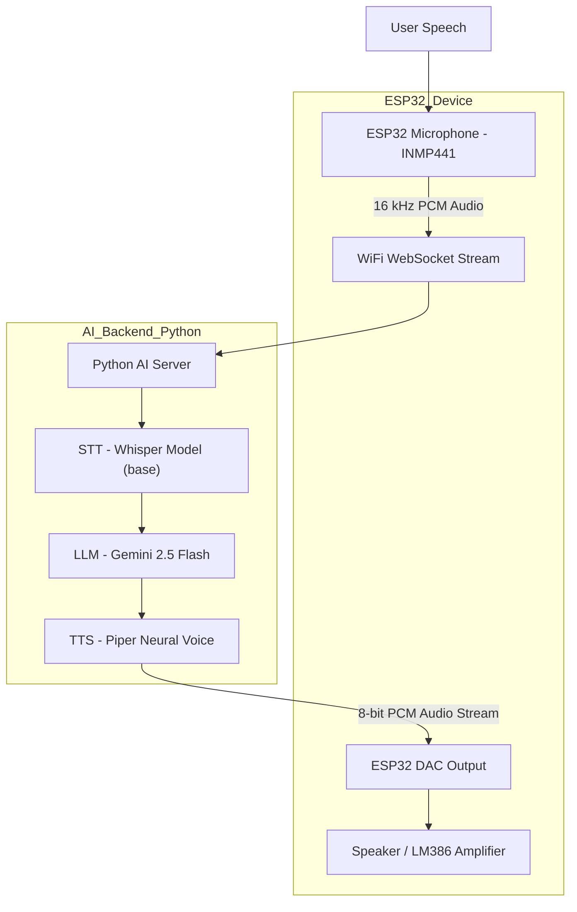

<div align="center">
  
  <p><strong>ESP32 based Voice Assistant</strong></p>
</div>
<br>


# ESP32 based Voice Assistant

## Project folders

The project is separated into two runnable parts:

```text
esp32/   Arduino IDE firmware for ESP32 DevKit V1
server/  Python WebSocket and AI backend
```

### ESP32 firmware

Open [`esp32/esp32.ino`](./esp32/esp32.ino) in Arduino IDE. Keep all files
inside the `esp32` folder. Copy [`secrets.example.h`](./esp32/secrets.example.h)
to `secrets.h`, enter the Wi-Fi and server settings, install the required
Arduino libraries, and upload to `ESP32 Dev Module`.

If the configured Wi-Fi cannot be found, the ESP32 no longer waits forever.
It creates an access point named `ESP32-Voice-Setup` with password
`esp32setup`. Connect a phone or computer to that network, open
`http://192.168.4.1`, enter the new Wi-Fi name/password and server host, then
save. The ESP32 stores these values in non-volatile preferences and restarts.
On the next startup it will use the new network. The configuration portal is
also the safe state: motors remain stopped until Wi-Fi is configured.

### Render server

For a server deployed on Render, use the public Render hostname without a
protocol prefix, for example `my-assistant.onrender.com`. Set the port to
`443`; the firmware uses `wss://` for the audio WebSocket and `https://` for
the robot-command API. Do not enter `https://` in the host field and do not
use Render's internal port `7860` from the ESP32. The Render service may still
listen internally on port `7860`.

The server also honors Render's `PORT` environment variable and falls back to
`7860` when run locally.

### Server

Open a terminal in [`server/`](./server/), install dependencies with `uv sync`,
and start the backend with `uv run main.py`. The server listens on port 7860.

<table style="width:100%; border-collapse:collapse; table-layout:fixed; font-family:system-ui, -apple-system, 'Segoe UI', Roboto, 'Helvetica Neue', Arial;">
  <thead>
    <tr>
      <th style="width:50%; text-align:left; padding:12px; border-bottom:2px solid #e6e6e6; font-size:1.05rem;">
        Overview
      </th>
      <th style="width:50%; text-align:left; padding:12px; border-bottom:2px solid #e6e6e6; font-size:1.05rem;">
        YouTube Video
      </th>
    </tr>
  </thead>
  <tbody>
    <tr>
      <td style="width:50%; padding:12px; vertical-align:top; line-height:1.5;">
        <strong>This project</strong> combines <strong>embedded systems</strong> and 
        <strong>AI inference</strong> to create an end-to-end conversational assistant.
        The <strong>ESP32</strong> handles real-time audio recording and playback, while a 
        Python backend performs:
        <ul style="margin:8px 0 0 20px; padding:0;">
          <li><strong>Speech-to-Text (STT)</strong> via Faster-Whisper</li>
          <li><strong>Language Understanding</strong> via Google Gemini</li>
          <li><strong>Text-to-Speech (TTS)</strong> using Piper TTS</li>
        </ul>
      </td>
      <td style="width:50%; padding:12px; vertical-align:top;">
        <a href="https://youtu.be/_BZOLwxb_aU" target="_blank" rel="noopener noreferrer">
          
        </a>
      </td>
    </tr>
  </tbody>
</table>

## System Architecture



---

## Hardware Architecture

| Component                                                                                                                                                                   | Function                                                          | Connection                 |
| --------------------------------------------------------------------------------------------------------------------------------------------------------------------------- | ----------------------------------------------------------------- | -------------------------- |
| **[ESP32-WROOM-32 38Pin Development Board](https://robu.in/product/esp32-38pin-development-board-wifibluetooth-ultra-low-power-consumption-dual-core/)**                    | Main microcontroller handling Wi-Fi, I2S mic input and DAC output |                           |
| **[INMP441 MEMS High Precision Microphone](https://robu.in/product/inmp441-mems-high-precision-omnidirectional-microphone-module-i2s/)**                                    | Captures real-time voice input                                    | `SCK=14`, `WS=15`, `SD=32` |
| **[LM386 Audio Amplifier Module](https://robu.in/product/lm386-audio-amplifier-module/)**                                                                                   | Drives small speaker output                                       | Input from `DAC1 (GPIO25)` |
| **[2inch 8Ohm 12W Midrange Speaker](https://www.rytronics.in/product/2inch-8ohm-12w-midrange-speaker-mid-bass-woofer-audio-speaker-subwoofer/)**                            | Plays synthesized voice from AI                                   | Connected to LM386         |
| **[12x12x12mm Tactile Push Button](https://robu.in/product/12x12x12mm-tactile-push-button-switch-10pcs/)**                                                                  | Triggers recording                                                | GPIO 26                    |
| **[TP4056 Adjustable 1A Li-ion lithium Battery Charging Module](https://robu.in/product/tp4056-1a-li-ion-lithium-battery-charging-module-with-current-protection-type-c/)** | Charges battery                                                   | VIN-(OUT+) / GND-(OUT-)    |
| **[1000mAh Rechargeable 3.7v Lithium Polymer Battery](https://robocraze.com/products/witty-fox-1000mah-rechargeable-3-7v-lithium-polymer-battery)**                         | Battery                                                           | +(B+) / -(B-)              |
| **LED (Built In)**                                                                                                                                                          | Status indication                                                 | GPIO 2 (BUILT IN)          |

> Refer to this sheet for a detailed BOM: [ESP32 Voice Assistant: BOM](https://docs.google.com/spreadsheets/d/1egNmfXN9Qd4uv5BD2DthPwsNbqICtmysUXRfdEgpIic)

The hardware supports **half-duplex streaming**, recording speech, sending it to the backend, waiting for a response and then playing it back via DAC.

## Schematic

<div align="center">
  
</div>
<br>

## Hardware Workflow

1. **Button Press**, ESP32 starts recording via the INMP441 microphone.
2. **I2S Audio Capture**, 16 kHz samples are streamed in real-time over WebSocket.
3. **AI Processing (Server)**

   - Whisper converts audio → text
   - Gemini 2.5 Flash generates a contextual reply
   - Piper converts text → natural speech

4. **Response Playback**, The server streams 8-bit PCM chunks back to ESP32 for DAC output.
5. **User Hears AI Voice**, LM386 amplifier drives the speaker.

## AI Backend (Python Server)

The **AI backend** acts as the brain of the device, hosted locally or on a VPS. It performs all heavy lifting, speech recognition, understanding and voice generation, so the ESP32 stays efficient.

### **Backend Modules**

| Layer                    | Description                                   | Library                 |
| ------------------------ | --------------------------------------------- | ----------------------- |
| **STT (Speech-to-Text)** | Converts voice input to text                  | `faster-whisper`        |
| **LLM (Language Model)** | Generates response based on transcribed query | `google-genai`          |
| **TTS (Text-to-Speech)** | Synthesizes natural human-like voice          | `piper-tts`             |
| **Transport Layer**      | Binary audio streaming and event control      | `websockets`, `asyncio` |

### **Processing Pipeline**

1. **Audio Reception**
   The ESP32 streams 16 kHz PCM data → server buffers in memory.
2. **Transcription**
   Whisper transcribes it into text using a lightweight `tiny` model for fast CPU inference.
3. **Response Generation**
   Gemini Flash LLM interprets intent and composes a short, empathetic response.
4. **Speech Synthesis**
   Piper TTS generates smooth, low-latency speech from text.
5. **Audio Encoding**
   Output audio is converted to 8-bit unsigned PCM and streamed back to the ESP32.

## Server Setup

```bash
cd esp-server
pip install uv
uv sync
uv run main.py
```

or via Docker:

```bash
docker build -t esp32-ws-server .
docker run -p 7860:7860 esp32-ws-server
```

> The server runs a WebSocket on `ws://0.0.0.0:7860` to communicate with ESP32.

### **Environment Requirements**

- Python ≥ 3.12
- Google Gemini API key (`GEMINI_API_KEY`)
- Pre-downloaded Piper voice model (`en_US-libritts_r-medium.onnx`)

> Model can be download using the following command:
> `python -m piper.download_voices en_US-libritts_r-medium --data-dir tts_models`

## System Highlights

- 🎧 **End-to-end Voice Interaction**, Speak → Understand → Reply → Speak
- ⚡ **Real-Time Processing**, WebSocket-based binary streaming under 100 ms latency
- 🔊 **High-Quality TTS**, Piper’s neural synthesis produces clean, expressive voice output
- 🧩 **Lightweight AI Core**, Whisper Tiny (CPU) enables fast offline operation
- 🧠 **LLM Personality Control**, Adjustable system prompt to alter the AI’s character
- 🔄 **Auto-Restart Watchdog**, `watcher.py` ensures uptime even after failure

## Final Outcome

||||
|-|-|-|

## License

This project is released under the **MIT License**.
See [LICENSE](./LICENSE) for details.

## Acknowledgements

- [Weslei Prudencio for Project Inspiration](https://github.com/wprudencio)
- [Faster Whisper by Systran](https://github.com/systran/faster-whisper)
- [Piper TTS by Rhasspy](https://github.com/rhasspy/piper)
- [Gemini API by Google](https://ai.google.dev/)
- [ESP-IDF & Arduino Core](https://github.com/espressif/arduino-esp32)

---

> Built with ❤️ by **Arpit Sengar**

## Mini robot expansion

The firmware now optionally supports an SSD1306 128x64 OLED and a TB6612FNG
dual motor driver while preserving the existing INMP441 + DAC/LM386 audio
pipeline. The current repository does **not** use the MAX98357A/I2S speaker
path described in some earlier hardware notes.

### GPIO map

| Function | GPIO |
| --- | ---: |
| INMP441 SCK / WS / SD | 14 / 15 / 32 |
| DAC audio to LM386 | 25 |
| Record button / status LED | 26 / 2 |
| OLED SDA / SCL | 4 / 5 |
| TB6612 PWMA / AIN1 / AIN2 | 33 / 27 / 13 |
| TB6612 PWMB / BIN1 / BIN2 | 16 / 17 / 18 |
| TB6612 STBY | 19 |

The motor pins intentionally differ from a generic TB6612 example because
GPIO25 and GPIO26 are already occupied by the existing audio output and
record button. Connect TB6612 `VCC` to 3.3 V, `GND` to common ground, and
`VM` to a separate motor supply. Never power the motors from the ESP32 3.3 V
pin. Install **Adafruit GFX**, **Adafruit SSD1306**, and **ArduinoJson** in
Arduino IDE, then compile the `esp32` folder as `ESP32 Dev Module`.

### Robot command API

The Python server exposes a one-shot FIFO queue:

```powershell
Invoke-RestMethod http://localhost:7860/simulate-robot-command `
  -Method Post -ContentType "application/json" `
  -Body '{"action":"left","speed":150,"duration_ms":800}'
Invoke-WebRequest http://localhost:7860/robot-command
```

Valid actions are `forward`, `backward`, `left`, `right`, and `stop`.
`speed` is 0-255 and `duration_ms` is 0-10000. The ESP32 polls this endpoint
without interrupting audio capture, stops after the requested duration, and
has a 1.5 second communication watchdog. Voice commands such as “move
forward for 2 seconds”, “turn left”, “đi thẳng 2 giây”, and “dừng lại” are
handled before the general LLM.

This is open-loop motion: there are no encoders, distance sensors, IMU, GPS,
or obstacle avoidance. A timed command cannot guarantee a fixed distance or
straight line. Add a physical emergency stop when testing.
